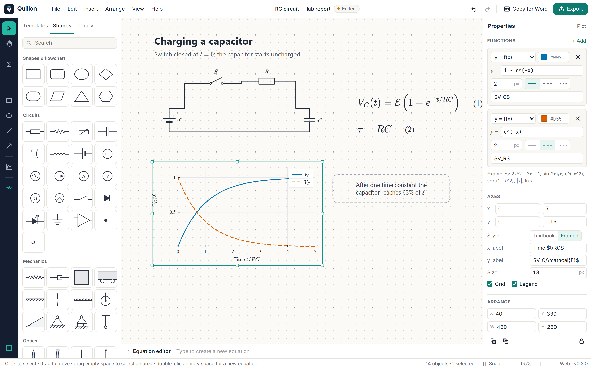
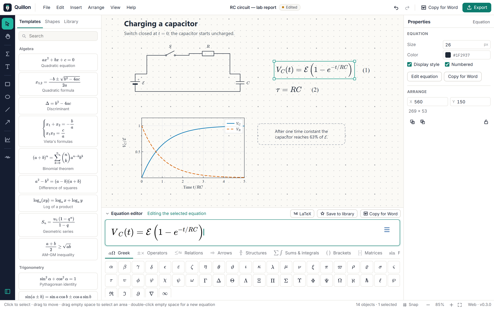
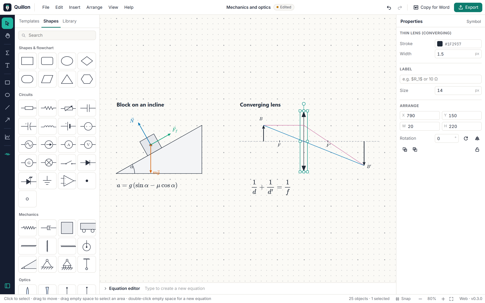
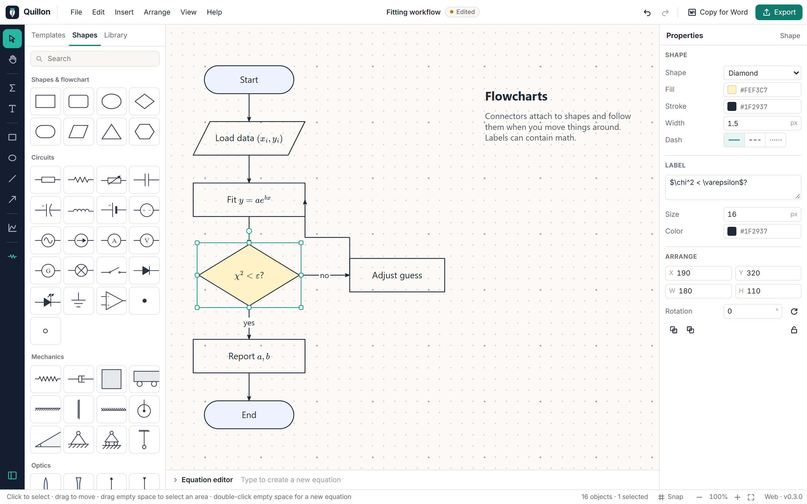
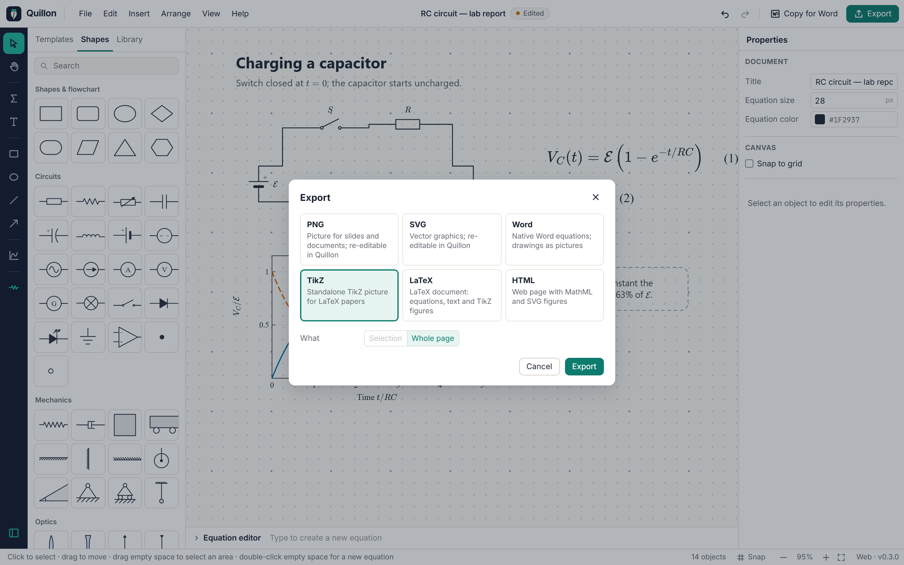
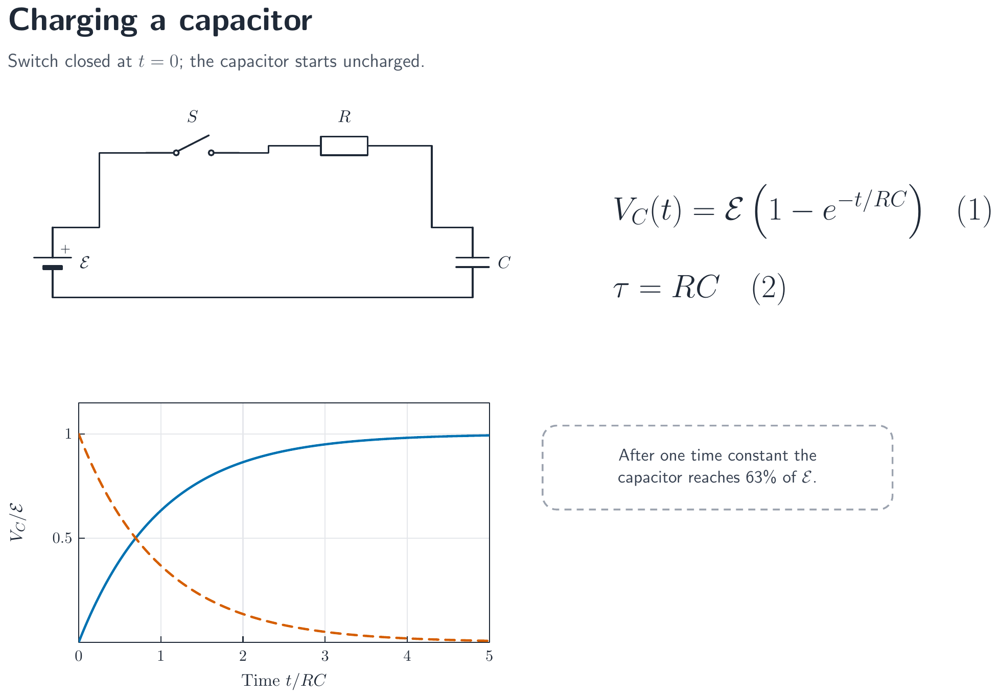

<div align="center">


# Quillon

**Equations, diagrams and scientific figures in one open-source app**<br>
for researchers, teachers and students

[](https://github.com/vinhhuy15/quillon/actions/workflows/ci.yml)
[](LICENSE)


[Download](#download) · [How it works](#how-it-works) · [Features](#features) · [Build from source](#build-from-source) · [Roadmap](docs/ROADMAP.md)

</div>



Quillon combines what usually takes three tools: an equation editor in the spirit of MathType, a diagram
editor for circuits, mechanics and flowcharts, and a plotter for functions. Everything lives on one page,
renders with real TeX typography, and goes straight into **Word** (as native, editable equations) or
**LaTeX** (as TikZ).

## Download

| Platform | |
|---|---|
| **Windows 10/11** | `Quillon_0.3.0_x64-setup.exe` from [Releases](https://github.com/vinhhuy15/quillon/releases). Installs per user, no admin rights needed. |
| **macOS / Linux** | `.dmg`, `.deb` and `.AppImage` builds come from CI (see [Actions](https://github.com/vinhhuy15/quillon/actions)), or [build from source](#build-from-source). |
| **Browser** | Run `npm run dev` and open `http://localhost:1420`. The whole app works in a modern browser. |

> Quillon was called **SciForge** up to version 0.2. Documents and images made with SciForge open unchanged.

## How it works

Open the app and the start card offers the four usual first steps:


### 1. Write the math

Type an equation the way you would say it, or type LaTeX. Pick symbols and structures from 11 palettes,
or start from one of ~50 templates. Equations are numbered automatically, in reading order.



### 2. Draw the figure

Pick a tool on the left, or drag a symbol from the **Shapes** panel. Wires snap to the terminals of circuit
symbols, and arrows stay attached to the shapes they connect. Labels anywhere can contain math, such as `$\vec F_f$`.
Plots take formulas written as you would on paper: `2x^2 - 3x + 1`, `sin x`, `e^(-x^2)`, `|x|`.





### 3. Export it where it is needed

**Copy for Word** pastes an equation as a native Word equation you can still edit, and a drawing as a sharp
picture. **Export** writes PNG, SVG, Word, TikZ, LaTeX or HTML.



The TikZ export compiles with plain `pdflatex`. Here is the page above, typeset by LaTeX:



Exported PNG and SVG files carry their source with them. Drop one back into Quillon and it becomes editable again.

## Features

**Equations**
- WYSIWYG editing with LaTeX input, 11 symbol palettes and ~50 templates (algebra, trigonometry, calculus, linear algebra, probability, physics, chemistry, including `\ce{}`)
- Automatic numbering, display or inline style, size and color, a personal library of saved formulas
- Copy as a native Word equation, or as LaTeX, MathML or an image

**Drawing and diagrams**
- Shapes: rectangle, rounded rectangle, ellipse, diamond, terminator, parallelogram, triangle, hexagon, with fill, stroke, dash style and rotation
- Lines and arrows: straight, elbow or curved, five arrow heads, labels; connectors stay attached when you move things
- 45 symbols: circuits (resistors, capacitors, inductors, sources, meters, diodes, LED, op-amp, switch, ground…), mechanics (spring, damper, mass, cart, pulley, incline, supports, pendulum…), optics (lenses, mirror, prism, screen, eye) and lab glassware
- Text with inline math anywhere: `Speed $v = \frac{d}{t}$ in m/s`
- Resize, rotate and flip handles; snap to grid; align and distribute; group, lock and z-order; right-click menu

**Plots**
- y = f(x), parametric and polar curves, several per plot, with colors, dashes and legend
- Textbook axes (through the origin, with arrows) or framed axes (for papers), grid and axis labels with math
- Asymptotes such as `tan x` are detected and broken cleanly

**Files and export**

| Format | What you get |
|---|---|
| `.qln` | Quillon document: an open ZIP + JSON format ([spec](docs/FILE_FORMAT.md)), with autosave and crash recovery. `.sci` files from SciForge open too |
| PNG | 96–1200 DPI, transparent or white background; re-editable in Quillon |
| SVG | Vector graphics; re-editable in Quillon |
| Word `.docx` | Native equations (numbered with tab stops); drawings embedded as pictures |
| TikZ `.tex` | Standalone picture for LaTeX papers; also *Copy TikZ* for pasting into an existing document |
| LaTeX `.tex` | Article with equations, text and TikZ figures |
| HTML | MathML equations and inline SVG figures |

**Everywhere:** unlimited undo/redo, English and Vietnamese interface, keyboard shortcuts for every tool.

## Keyboard shortcuts

| Keys | Action |
|---|---|
| `V` `H` | Select · pan |
| `M` `T` | Equation · text |
| `R` `O` `L` `A` | Rectangle · ellipse · line · arrow |
| `P` | Function plot |
| `Shift` while drawing | Square or circle, 15° angles, keep proportions |
| Double-click | Edit an equation, text or label · on empty space: new equation |
| `Ctrl+Shift+C` | Copy for Word |
| `Ctrl+G` / `Ctrl+Shift+G` | Group / ungroup |
| `Ctrl+R` · `Ctrl+L` | Rotate 90° · lock |
| `Ctrl+J` · `Ctrl+\` | Show or hide the equation editor · the insert panel |
| `Ctrl+E` | Export |

`F1` in the app lists all shortcuts.

## Build from source

Requires Node.js ≥ 20.

```bash
git clone https://github.com/vinhhuy15/quillon.git
cd quillon
npm install
npm run dev          # http://localhost:1420
```

```bash
npm test             # unit tests (document model, math pipeline, figures, palette content)
npm run typecheck
npm run build        # static web build in apps/desktop/dist
```

**Desktop app.** This also needs [Rust](https://rustup.rs) and the [Tauri prerequisites](https://tauri.app/start/prerequisites/)
(on Windows: *Microsoft C++ Build Tools* and WebView2, which Windows 11 already has).

```bash
npm run tauri dev               # desktop window with hot reload
npm run tauri build             # installers for the current OS
```

The README screenshots are produced by `node scripts/screenshots.mjs` while `npm run dev` is running.

## Project layout

```
packages/doc-model     Document schema, validation and migration, pure commands, undo/redo, .qln files
packages/math-core     LaTeX → SVG/MathML (MathJax), MathML → OMML for Word, .docx writer, image metadata
packages/figure-core   Layout of every object, shapes, connectors, symbols, plots, rich text, TikZ export
apps/desktop           React app (MathLive editor); src-tauri/ is the Tauri 2 desktop shell
docs/                  Architecture, file format, roadmap
```

How the pieces fit together is described in [docs/ARCHITECTURE.md](docs/ARCHITECTURE.md).

## Roadmap

| | Phase | |
|---|---|---|
| ✅ | 0–1 · Foundation and equation editor | v0.1 |
| ✅ | 2 · Drawing, diagrams, symbols, plots, TikZ | v0.2 |
| ✅ | Identity · new name, logo, icon and design | v0.3 |
| ⏭ | 3 · Constraint-based geometry and basic 3D | next |
| | 4 · Figure composer, journal presets, image tools | |
| | 5 · Data charts, curve fitting, plot digitizer | |
| | 6 · Plugins, math OCR, symbolic calculator, Office add-in | |

Details and known gaps: [docs/ROADMAP.md](docs/ROADMAP.md).

## Contributing

Bug reports, symbols, templates, translations and code are all welcome. See [CONTRIBUTING.md](CONTRIBUTING.md).

## License

[Apache-2.0](LICENSE). Built on MathJax (Apache-2.0), MathLive (MIT), fflate (MIT), React (MIT) and Tauri (Apache-2.0/MIT).
